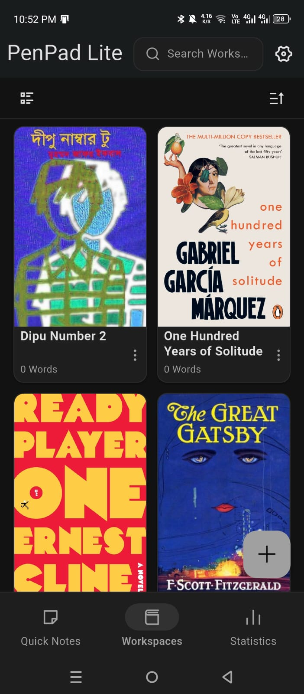
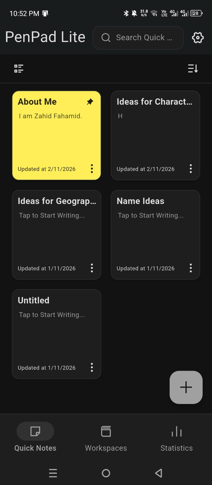
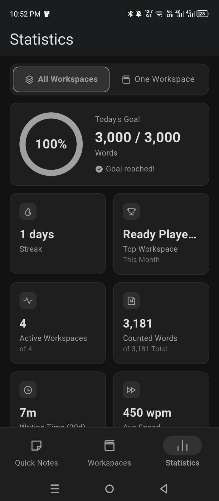
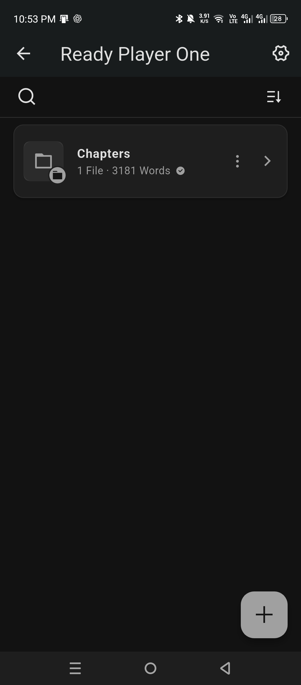
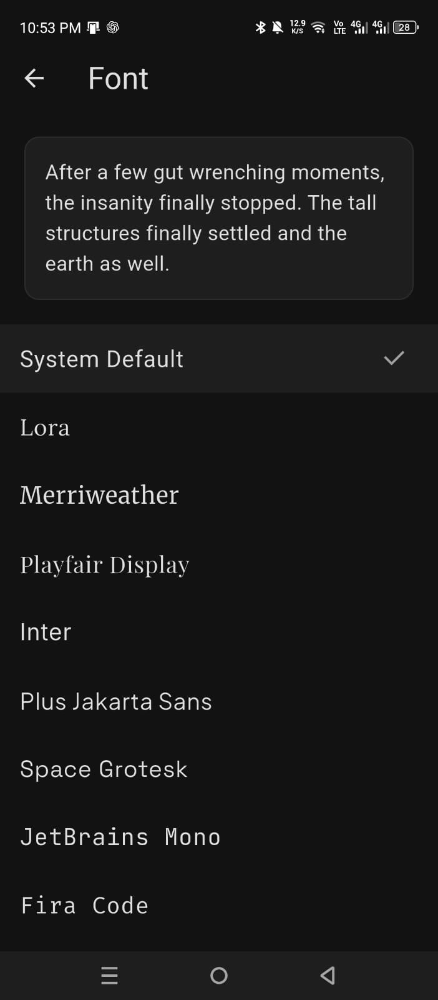
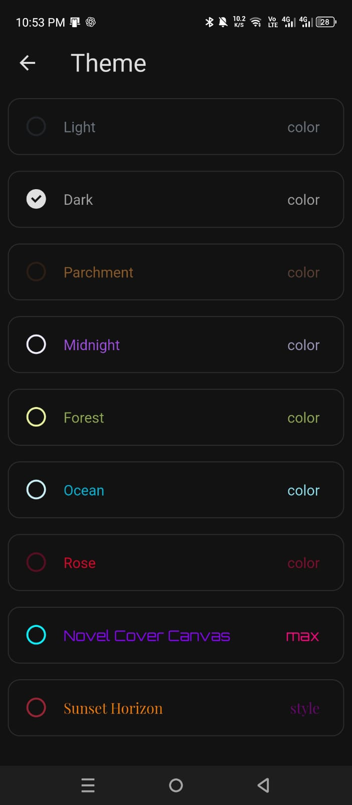
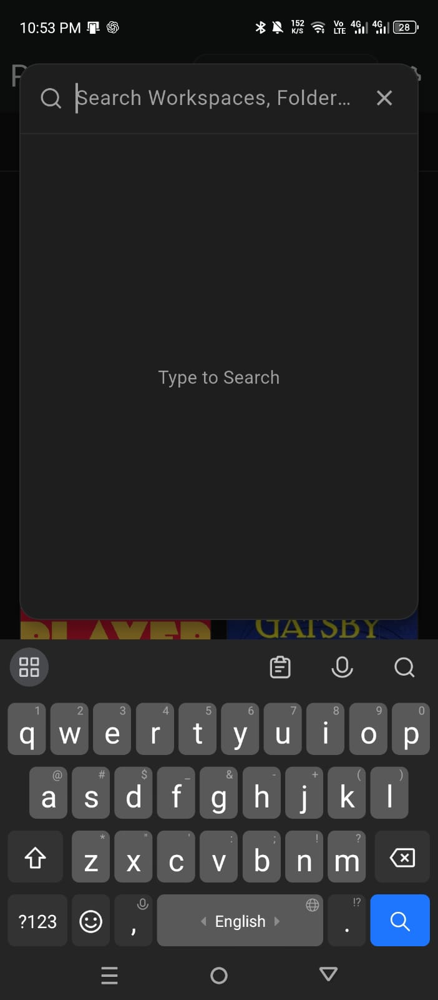
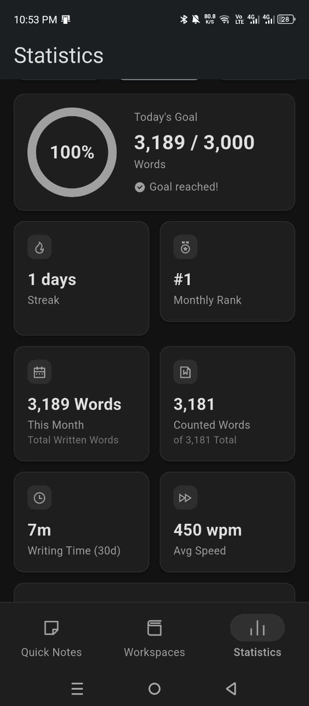
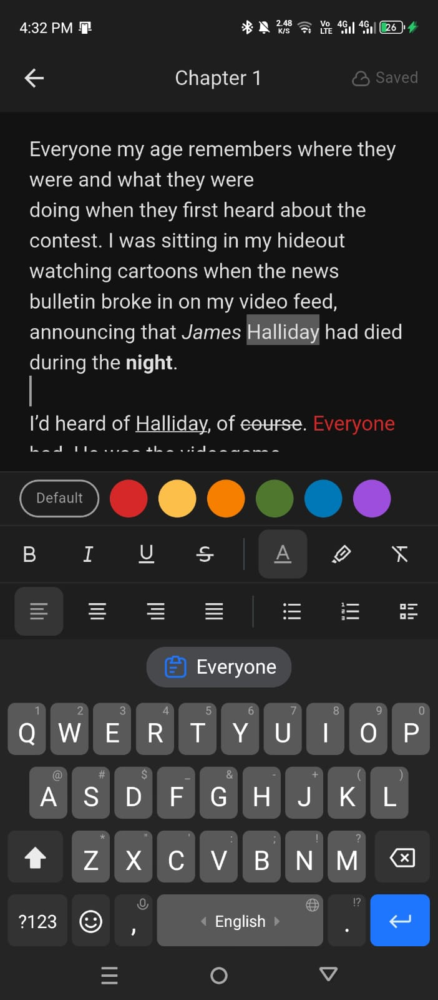

# PenPad Lite

**A lightweight, offline-first writing app for organizing your stories, notes and ideas.**

---

## Screenshots

| | | |
| :---: | :---: | :---: |
|  |  |  |
|  |  |  |
|  |  |  |

## Features

- **Workspaces** – keep every project in its own space.
- **Folders and files** – nest folders as deep as you like, with text files and image files.
- **Rich text editor** – formatting for your writing.
- **Quick notes** – capture an idea instantly, then forward it into any workspace and folder later.
- **Search and sorting** – find anything fast; sort by name or date; pin what matters.
- **Themes and fonts** – several themes and writing fonts.
- **Backup** – export and restore your data as a ZIP file.
- **Offline-first** – everything stays on your device. No account, no tracking.

## Download

Pick the file that matches your phone. **If you're not sure, download the first one (arm64-v8a)**, since it works on almost every phone made in the last several years.

| Download | Works on | Notes |
| --- | --- | --- |
| [**PenPad-Lite-v1.0.0-arm64-v8a-release.apk**](https://github.com/YOUR_USERNAME/penpad-lite/releases/download/v1.0.0/PenPad-Lite-v1.0.0-arm64-v8a-release.apk) | Most modern Android phones and tablets (64-bit ARM) | **Recommended** |
| [**PenPad-Lite-v1.0.0-armeabi-v7a-release.apk**](https://github.com/YOUR_USERNAME/penpad-lite/releases/download/v1.0.0/PenPad-Lite-v1.0.0-armeabi-v7a-release.apk) | Older and some budget phones (32-bit ARM) | Use only if the first one won't install |
| [**PenPad-Lite-v1.0.0-x86_64-release.apk**](https://github.com/YOUR_USERNAME/penpad-lite/releases/download/v1.0.0/PenPad-Lite-v1.0.0-x86_64-release.apk) | Android emulators, Chromebooks and rare Intel-based devices | Not for regular phones |

All versions are also listed on the [Releases page](https://github.com/YOUR_USERNAME/penpad-lite/releases).

> **Requires Android 6.0 (Marshmallow) or newer.**

### Not sure which one to pick?

- If you're on a phone released after about 2017, choose **arm64-v8a**.
- If it says *"App not installed"* or *"Package appears to be invalid"*, try **armeabi-v7a**.
- Choose **x86_64** only for an emulator on a PC.

## How to install

1. Download the APK on your Android phone using the table above.
2. Open the downloaded file from your notifications or the **Downloads** folder.
3. If Android asks, allow **Install unknown apps** for your browser or file manager.
4. Tap **Install**, then **Open**.

Your phone may show a warning because the app isn't from the Play Store. That is normal for APKs downloaded directly.

## Tech

Built with Flutter, using Riverpod for state, Drift (SQLite) for storage and Flutter Quill for the editor.

---

Made by <a href="https://github.com/YOUR_USERNAME">YOUR_NAME</a>

